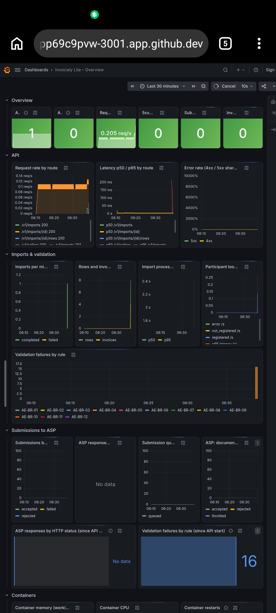
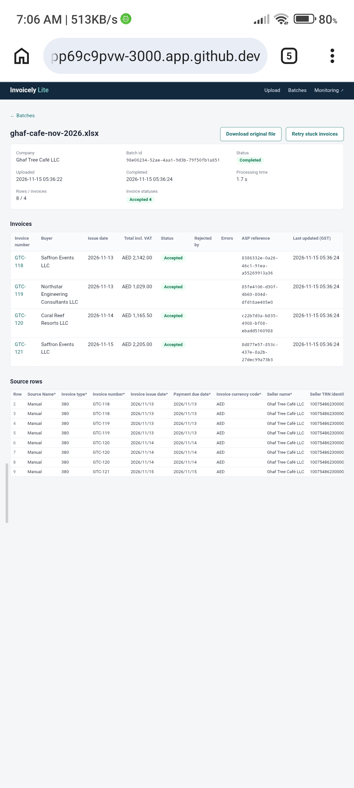

# Submission

- **Name:** SHIJU A
- **Date submitted:** 14-11-2026
- **Repository link:** https://github.com/shijuavtm-sudo/New-Assessment
- **Total time spent (real time):** Approximately 3 hour

> Replies below are drafts written on the **exercise clock** (Monday 16 November 2026, Asia/Dubai). Keep your real time in the time log at the end. Put screenshots, log excerpts and query output in `evidence/` and link to them.

> **Required:** the Acknowledgement and Priority sections for **all five** items, and the full write-up (investigation log onwards) for **at least three** items of your choice. For an item you did not fully investigate, replace the remaining sections with "Not investigated — what I would check next: …".

- **Items I fully investigated, and why I chose them:**
   
    1. Oasis Builders upload stuck : I chose this incident because repeated uploads caused timeout and duplicate invoice errors. I checked the batches, processing times and available logs to understand what happened and identify the possible cause.
   
    2. API Restart — Marina Bay Hospitality: I chose this incident because the API restarted three times within 15 minutes, and multiple customers reported 502 errors. I reviewed the Grafana alert and customer escalation to understand the impact on invoice processing.

    3. Al Noor Fuel & Lubricants: I chose this incident because three out of six invoices were rejected due to the BR-CO-15 validation error. I checked the batch results and identified the affected invoices.
    4. Ghaf Tree Cafe : I selected this incident because all four invoices in the attached workbook were blocked by date-format validation. To resolve this, I reviewed the workbook values and traced the portal’s validation path to distinguish between a valid calendar date and a supported input format.

 I selected these incidents because they provided useful evidence to understand different technical issues and their customer impact. Some technical root causes still need further verification.
 
---

## Incident 1 — `inbox/01-oasis-builders-upload-stuck.md`
### Acknowledgement

- **Sent at (exercise clock):** 9.10 AM
- **Reply:**
   Dear Rashid,
  
     Thank you for contacting Invoicely Lite Support.
  
     We understand the urgency of this issue, particularly during your month-end closing process.
  
     We apologise for the inconvenience caused by the upload remaining in Processing and the subsequent document number       already exists errors.
  
     We are investigating your three upload attempts to determine which invoices have been successfully processed and         sent to the ASP.
  
     Please do not attempt another upload or retry the same file until we complete our investigation. This will help          prevent additional duplicate submissions.

    We will check the processing records and invoice statuses and provide you with a clear update on which invoices          were successfully submitted and how to safely process the remaining invoices.

  Kind regards,

  Invoicely Lite Support Team
> …
  
### Priority and justification

- **Priority:** P2
- **Why:**
- The customer uploaded the same monthly invoice file three times.
- The portal remained stuck on Processing.
- The frontend returned a 504 Gateway Timeout.
- Each upload contained 600 rows and 8 invoices.
- Processing took approximately 121 seconds per batch.
- Duplicate document-number errors appeared after repeated uploads.
- The customer cannot identify which invoices were successfully submitted.
- Month-end closing and customer invoice issuance are affected.
   
- **SLA deadlines I am working to:**
- First response: 09:10 AM .
- Next update: To be confirmed using docs/escalation-policy.md.
- Resolution target: To be confirmed using docs/escalation-policy.md.

### Investigation log

| Time (exercise clock) | What I checked / did | What I found |
|---|---|---|
|9.10 |Reviewed the customer support email |Customer reported three upload attempts, Processing delays and duplicate document-number errors. |
|investigation | Replayed the Oasis Builders scenario using make replay CUSTOMER=oasis. | Docker successfully created the tools container and initiated the Excel upload. |
| investigation | Observed the frontend upload response. | The frontend returned HTTP 504 Gateway Timeout. |
| investigation | Compared batch details and Reviewed the Batches page. | Each batch contained 600 rows and 8 invoices and Found three Oasis Builders uploads of the same November file. |
| investigation | Reviewed application logs and Api log | Observed HTTP 200 responses from the ASP with response durations of a few milliseconds. |
| 9.18 |Checked the Batches dashboard again | Approximately 40 seconds later, the batch showed successful completion. |
| 9.20 | Reviewed the batch details |600 source rows, 8 invoices, all 8 accepted, processing time 120.8 seconds.|

### Root cause

- **What happened:**  Oasis Builders uploaded the same November Excel file three times. Each file contained 600 source rows representing 8 invoices.
  
During the upload, the frontend displayed a 504 Gateway Timeout after approximately 60 seconds. However, when I checked the Batches dashboard approximately 40 seconds later, it showed a successful batch result.
The batch record showed 8 invoices accepted and a recorded processing time of 120.8 seconds.

This indicates that the customer-facing upload request timed out before the batch result became available. The evidence suggests that backend processing continued after the frontend or gateway returned the timeout

- **Where** (component, `file:line`):
- Suspected components:
  -  Frontend upload request and timeout handling.
  -  Backend Excel import and invoice-processing service.
  -  Gateway or reverse-proxy timeout configuration.
  -  Invoice duplicate-detection and retry-handling logic.
  -  The exact source-code location has not yet been confirmed.
  
- **Why it happens:**
  The likely issue is that invoice processing takes longer than the configured 60-second request timeout.
  
The gateway returns HTTP 504 because it does not receive a response within the allowed time. However, the backend may continue processing the uploaded file.

The customer sees the timeout message and may retry the same file. If the original batch has already created invoice records, the subsequent upload may encounter duplicate document-number errors.

The exact relationship between the timeout, continued backend processing and duplicate errors still needs to be confirmed using application and gateway logs.

- **Evidence:**
  1.Frontend screenshot showing the 504 Gateway Timeout after approximately 60 seconds.
  2.Batches dashboard showing successful processing after approximately 40 additional seconds.
  3.Batch record showing 600 source rows and 8 invoices.
  4.Batch result showing all 8 invoices accepted.
  5.Recorded batch processing time of 120.8 seconds.
  6.Three upload attempts involving the same November file.
  7.API and ASP logs showing successful HTTP 200 responses.
  8.Grafana Invoicely Lite Overview dashboard.
 
- **Confidence and open questions:**
  High confidence that the frontend upload request timed out while the batch subsequently appeared successful in the dashboard.
The likely cause is a long-running upload request combined with a shorter gateway timeout.
Further verification is needed to establish:
1. Whether backend processing continued  after the 504 response.
2. Which component generated the 504 response.
3. Whether all three upload attempts created invoice records.
4. Whether duplicate errors were caused by retries of invoices already processed.

### Customer resolution reply OR escalation note

- **Which one and why:**
Customer update. The issue affects invoice issuance and month-end closing. The technical investigation is not complete, so an update is more appropriate than claiming a confirmed resolution.
>
> Dear Rashid,

We have started investigating your November invoice uploads.

Our initial checks identified three upload batches containing the same 600-row Excel file. The upload page displayed a 504 Gateway Timeout after approximately 60 seconds.

However, when we checked the Batches dashboard, we found that the batch had subsequently completed successfully, with all 8 invoices accepted. The recorded processing time was approximately 120.8 seconds.

This suggests that the upload request timed out before the backend processing result was returned to the portal.

We are continuing to reconcile all three upload attempts to identify which invoices were successfully submitted and whether any duplicate records were created.

Please do not upload the same file again until we complete this verification.

We will provide you with a breakdown of the accepted, rejected and unprocessed invoices, together with the recommended steps for safely processing any remaining invoices.

We apologise for the inconvenience and understand the importance of resolving this before your month-end closing.

Kind regards,

Invoicely Lite Support Team

### Workaround offered
 - Do not retry the same file until verification is complete.
 - Check invoice statuses across all three batches.
 - Identify accepted and unprocessed invoices.
 - Retry only invoices confirmed as not submitted.
 - Preserve the original Excel file.
   
### Prevention ideas
 - Implement asynchronous background processing.
 - Use idempotency keys to prevent duplicate invoices.
 - Improve upload progress and status messages.
 - Add safe retry functionality.
 - Monitor long-running uploads.
 - Provide invoice-level reconciliation reports.
 - Test large uploads and repeated submissions.
---

## Incident 2 — `inbox/02-alert-api-restarted-marina-bay.md`

### Acknowledgement

- **Sent at (exercise clock):** 10 AM
- **Sent to:**  support-oncall@invoicely-lite.example
- **Reply:**   
> …
> Hi Priya,

Thank you for flagging this issue.

We have received the critical alert indicating that the Invoicely API restarted three times within 15 minutes.

We are treating this as a high-priority production incident because multiple customers are reporting intermittent 502 
Bad Gateway errors and some invoices are remaining in Validated status.

Our team is investigating the API restart events, application logs and invoice-processing pipeline to identify the cause and assess the impact.

We will also review the readiness of the service for Marina Bay Hospitality's scheduled go-live on 18 November.

Please share any additional customer reports or affected invoice references with us.
We will keep you updated as the investigation progresses.

Kind regards,

Invoicely Lite Support Team

### Priority and justification

- **Priority:** P1
- **Why:**
 - Because the production API restarted three times within 15 minutes.
 - Grafana generated a critical alert.
 - Multiple customers reported intermittent 502 Bad Gateway errors.
 - Some invoices have been stuck in Validated status since approximately 09:45 AM.
 - The problem may affect multiple customers and the invoice-processing pipeline.
 - Marina Bay Hospitality has an upcoming production go-live on 18 November.
 - The incident requires immediate technical investigation and coordination with engineering and Customer Success.

- **SLA deadlines I am working to:**
 - First response: Target 10 AM, following the 09:42 AM alert.
 - Next update: According to the P1 update interval in docs/escalation-policy.md.
 - Resolution target: According to the P1 resolution target in docs/escalation-policy.md.

### Investigation log

| Time (exercise clock) | What I checked / did | What I found |
|---|---|---|
| 09:42 | Reviewed the Grafana alert email.| Critical alert reported three API restarts within 15 minutes. |
| 09.48 | Reviewed priya nair's escalation message | Multiple customers reported intermittent 502 errors |
| 09.48 | Reviewed the reported invoice-processing issue. | Some invoices had remained in Validated status since approximately 09:30 AM. |
| 09.50 | Reviewed the upcoming customer go-live information. | Marina Bay Hospitality was scheduled to go live on Wednesday, 18 November. |
| pending | Checked Docker container status and restart counts. |  identified whether the API container is currently stable. |
| pending | Inspected API logs around the restart timestamps. |  identified the reason for the restarts. |
| pending | Checked Grafana API availability, latency and error-rate panels. | identified to correlate API failures with the restart events. |
| pending | Reviewed application resource usage. | identified the memory, CPU and database connectivity issue. |

### Root cause

- **What happened:** Grafana generated a critical production alert because the Invoicely API restarted three times within 15 minutes.

  At approximately the same time, multiple customers experienced intermittent 502 Bad Gateway errors, and some invoices remained in Validated status without progressing.

- **Where** (component, `file:line`): Affected component: Invoicely API container and its invoice-processing dependencies.

  Exact source-code file and line number have not yet been identified.

- **Why it happens:** The API container experienced repeated restarts, potentially interrupting requests and invoice-processing operations.

  Possible causes include application crashes, memory exhaustion, unhandled exceptions, database connectivity problems or container health-check failures.

  These are investigation hypotheses. The actual restart reason must be established from Docker and application logs.

- **Evidence:**
  - Grafana alert email showing `restarts=3`.
  - Alert severity: critical.
  - Environment: production.
  - Service: api.
  - Priya Nair's escalation reporting intermittent 502 errors.
  - Report of invoices stuck in Validated status since approximately 09:42 AM.
  - Grafana Invoicely Lite Overview dashboard.
  - 
- **Confidence and open questions:**
 - High confidence that the API experienced repeated restarts and customers reported production errors.
 - The root cause of the restarts and the relationship between the restarts and stuck invoices remain unconfirmed.
   **open question**
   1. Why did the API container restart three times?
   2. Was the container terminated because of an out-of-memory event?
   3. Is api stable now? 
### Customer resolution reply OR escalation note

- **Which one and why:**
   Internal engineering escalation. This is a critical production incident affecting multiple customers, so engineering
   investigation and coordinated incident ownership are required.
  **Escalation note:**
  **Title:** P1 — Production Invoicely API restarting repeatedly, intermittent 502 errors.
  **Affected service:** Invoicely API.
  **Environment:** Production.
  **Alert:** Three API restarts within 15 minutes.
> …
 **Customer Success update:**
   Hi Priya,

>   We have raised this as a high-priority production incident with engineering.
    The team is investigating the repeated API restarts and their impact on invoice processing.
    We will verify service stability and review the remaining Validated invoices before providing a readiness update for     Marina Bay Hospitality.
    We will keep you informed as soon as we have confirmed findings.

   Kind regards,

   Invoicely Lite Support Team
   
### Workaround offered
   - Avoid repeatedly retrying invoice uploads while the API is unstable.
   - Record the affected invoice references and batch IDs.
   - Check invoice statuses before attempting resubmission.
   - Verify ASP submission status before retrying invoices.
   - 
### Prevention ideas
   1. Investigate and resolve the underlying API restart cause.
   2. Introduce improved application crash monitoring.
   3. Monitor container memory and CPU usage.
   4. Improve API health checks and restart alerts.
   5. Implement reliable background invoice-processing workers.
   6. Add automatic recovery for interrupted invoice-processing jobs.
---

## Incident 3 — `inbox/03-al-noor-fuel-br-co-15.md`

### Acknowledgement

- **Sent at (exercise clock):** 10.20
- **Reply:**

Dear Fatima,

Thank you for reporting the issue and providing the November invoice file.
We understand the importance of resolving these validation failures, particularly during your VAT audit review.
We are investigating why certain invoices were rejected with BR-CO-15 while other invoices in the same upload were accepted.
We will verify the invoice totals, VAT calculations and validation process. We will also identify whether any corrections are required on your side.
Please avoid repeatedly uploading the rejected invoices until we complete our investigation, to prevent possible duplicate submissions.
We will provide an update with our findings and recommended next steps.

Kind regards,

Invoicely Lite Support Team

> …

### Priority and justification

- **Priority:** P3
- **Why:**
   - Multiple invoices are affected.
   - It concerns VAT compliance.
   - The customer has an active auditor review.
   - Other invoices were accepted, so this does not yet appear to be a complete service outage.
   
- **SLA deadlines I am working to** (first response / next update / resolution target):
     resolution target
  To be confirmed against `docs/escalation-policy.md`.
  Proposed first acknowledgement time: 10:20 AM.
### Investigation log

| Time (exercise clock) | What I checked / did | What I found |
|---|---|---|
| 10.20 |Acknowledged the customer's report |Confirmed that the issue concerns BR-CO-15 validation failures. |
| 10:25 |Opened the Al Noor Fuel batch in the portal. | The batch contained six invoices and showed Completed status. |
| 10.27 | Reviewed individual invoice statuses | Three invoices were accepted and three were rejected. |
| 10.30 | Reviewed the rejection details in the portal and Identified rejected invoice numbers. | Each rejected invoice showed one error and no ASP reference and  this invoices ANF-2611-0042, ANF-2611-0044 and ANF-2611-0046 were rejected by the ASP |
| 10.40 | Compare accepted and rejected invoice totals using database queries. |  Further evidence required |

Include dead ends and hypotheses you ruled out

### Root cause

- **What happened:**  Three invoices from Al Noor Fuel's November upload were rejected with BR-CO-15. This validation rule requires the invoice total including VAT (IBT-112) to equal the total excluding VAT (IBT-109) plus the total VAT amount (IBT-110).
- **Where** (component, `file:line`):Not confirmed yet. The invoice calculation, XML generation and ASP validation components need to be inspected.

- **Why it happens:** The exact technical reason has not yet been established. Possible areas to investigate include VAT calculation, decimal precision, rounding and invoice total generation

  
- **Evidence** (Grafana panels or queries, log lines, database queries, code references — link to `evidence/`):
-  1. Portal screenshot: 
   2. Batch status: Completed.
   3. Invoice count: Six.
   4. Accepted invoices: Three.
   5. Rejected invoices: Three.
   6. Rejected invoice numbers: ANF-2611-0042, ANF-2611-0044 and ANF-2611-0046.
   7. ASP rejection reason: BR-CO-15.
   
- **Confidence and open questions:**
     High confidence that the three invoices failed the BR-CO-15 validation reported by the customer and shown in the   portal.

  The underlying calculation or data-processing cause is not yet confirmed. Further investigation is required before recommending any correction
  
### Customer resolution reply OR escalation note

- **Which one and why:**
Customer update. The investigation is not complete, so I should not provide an unverified technical explanation or escalate without sufficient evidence.
> …
**Reply:**

Dear Fatima,

We have reviewed your November invoice batch.

Our initial investigation confirms that three of the six invoices were accepted, while three were rejected with BR-CO-15 validation errors.

We are now examining the VAT calculations and invoice validation process to identify the reason for the difference.
At this stage, we cannot confirm that any changes to your original figures are required.
Please continue to retain the original invoice file and avoid resubmitting the rejected invoices until we confirm the appropriate next step.
We will share a further update once our technical investigation is complete.

Kind regards,

Invoicely Lite Support Team

(For an escalation, use the template in [docs/escalation-policy.md](docs/escalation-policy.md). If you escalate, also include the update you send the customer.)

### Workaround offered
- Keep the original Excel file unchanged for audit purposes.
- Avoid repeatedly uploading the rejected invoices.
- Do not manually change VAT amounts without confirming the calculation discrepancy.
- Once the cause is identified, provide corrected invoice data or a verified reprocessing option, as appropriate
### Prevention ideas
- Use accurate decimal arithmetic for VAT calculations.
- Apply consistent rounding rules during invoice generation.
- Validate the relationship between IBT-109, IBT-110 and IBT-112 before sending invoices to the ASP.
- Add automated tests for VAT calculations and rounding edge cases.
- Improve error reporting to identify the exact invoice and calculation causing validation failure.

---

## Incident 4 — `inbox/04-bluepeak-sahara-not-received.md`

### Acknowledgement

- **Sent at (exercise clock):** 
- **Reply:**
   

> …

### Priority and justification

- **Priority:**
- **Why:**
- **SLA deadlines I am working to:**

### Investigation log

| Time (exercise clock) | What I checked / did | What I found |
|---|---|---|
| | | |

### Root cause

- **What happened:**
- **Where** (component, `file:line`):
- **Why it happens:**
- **Evidence:**
- **Confidence and open questions:**

### Customer resolution reply OR escalation note

- **Which one and why:**

> …

### Workaround offered

### Prevention ideas

---

## Incident 5 — `inbox/05-ghaf-cafe-date-error.md`

### Acknowledgement

- **Sent at (exercise clock):** 12.15 PM
- **Reply:**
   Dear Hessa Al Ketbi,
  Thank you for contacting Invoicely Life Support.
  We understand your frustration, especially when all your invoices have been rejected and your customers are waiting for them.
  We reviewed the error message and confirmed that the date you entered, 13/11) 2026,represents a valid calendar date.However, our system expects dates in YYYY-MM-DD format.
  We are investigating the date-format validation in the excel import process to understand why commonly used date formats are not accepted.
  As a temporary workaround, please use YYYY-MM-DD format for invoice issue dates.
  We apologies for the inconvenience and will provide an update on our findings.

King regards, 

Invoicely Lite Support Team

> …

### Priority and justification

- **Priority:** P4
- **Why:** The all invoices were rejected due to date format issue. The customer cannot issue invoices to their customers. The issue affects an entire customer batch. so the customer requires assistance to continue invoices processing.
  
- **SLA deadlines I am working to:**
  - First Response: 12.15 PM
  - Next Update: 12.30 PM
### Investigation log

| Time (exercise clock) | What I checked / did | What I found |
|---|---|---|
| 12.15 | Reviewed customer email| Customer reported that all invoices were rejected |
| 12.18 | Reviewed the batch in the portal | Batch contained 8 rows and 4 ininvoices
| 12.20 | Checked batch processing resluts| All 4 invoices were rejected |
| 12.25 | Reviewed grafana it showed the validation error and Reviewed Validation error| System expected YYYY-MM-DD but received 13/11/2026.|
| 12.25 | Reviewed the validation behavior and Sql Schema | The application rejected the date representation rather than establishing that the calender date was invalid. |

### Root cause

- **What happened:** All four invoices in Ghaf Tree Cafe November batch were rejected because the invoice issue date did not match the format expected by the application. 
- **Where** (component, `file:line`): Invoice excel important and date-validation process.Exact error was in excel file date format.
  
- **Why it happens:** The application execpts dates in YYYY-MM-DD format,but the customer supplied the date in DD/MM/YYYY format.
  
- **Evidence:**
 - Customer email reporting the issue.
 - Batch: ghaf-cafe-nov-2026.xlsx.
 - Source rows: 8.
 - Total invoices: 4.
 - Rejected invoices: 4.
 - Validation error: got '13/11/2026'.
 - Expected format: YYYY-MM-DD.
 - Screenshot of the completed batch :
 - Error
   
 - Corrected Page
    
    

- **Confidence and open questions:**
High confidence that the four invoices were rejected because of the date-format validation error.
Further investigation is required to establish the exact validation code location and whether Excel-native date values are also affected.
### Customer resolution reply OR escalation note

Dear Hessa Al Ketbi,

We have reviewed your November invoice batch and identified the date-format validation issue.

All four invoices were rejected because the system expects the invoice issue date in YYYY-MM-DD format.

Your date, 13/11/2026, is valid. The corresponding date in our required format is 2026-11-13.

As a temporary workaround, please update the date format to YYYY-MM-DD before uploading the file again.

We apologise for the inconvenience and appreciate your patience.

Kind regards,

Invoicely Lite Support Team

### Workaround offered
 - Convert dates from DD-MM-YYYY to YYYY-MM-DD or YYYY/MM/DD.
 - Verify the corrected dates before uploading. 
 - Check the invoice statuses before resubmission to avoid duplicate invoices.
   
### Prevention ideas
- Support commonly used date formats during Excel imports.
- Automatically normalize valid dates into YYYY-MM-DD.
- Provide clear validation messages with examples.
  
---

## Overall

### Prioritisation

I gave the highest priority to Incident 2 because the API restarted three times and multiple customers experienced 502 errors. It could affect the entire production service.

My next priority was Incident 1 because repeated uploads caused timeouts and duplicate invoice errors, affecting the customer's month-end work.

Incident 3 was my third priority because VAT validation failures affected invoice submissions and the customer's audit process.

I prioritised the remaining incidents based on their urgency and customer impact. I focused first on issues that could affect multiple customers or interrupt important business operations.

The order in which you worked the five items, and why. Did you change your mind as you learned more?

### What I would do differently

I would check the escalation policy and system logs earlier. I would also collect screenshots and database evidence during each investigation instead of doing it later. This would help me identify root causes faster and provide more accurate updates.

### What I learned / what I would need to learn

Be specific: concepts, tools or parts of the system that were new to you, how you got up to speed, and what you would study next.

 I learned how to investigate API errors, container restarts, gateway timeouts and invoice validation failures.
 I also gained practical experience with Docker Compose, Grafana, API logs and batch processing.

### Time log (real time)

| Date | From–to | What I worked on |
|---|---|---|
|14-11-2026 | Approximately 3 hours | Reviewed the assessment, investigated incidents, checked application logs and dashboards, and prepared the submission. |

### AI usage disclosure

I used ChatGPT to understand technical issues, organise investigation findings, Readme file creation and Api issues. 
I learned how to solve root cause error

